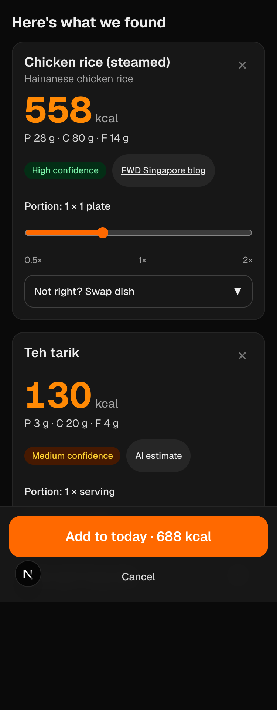

# MakanLens

Snap or describe a Singapore hawker meal and get calories and macros in seconds. Free, open source (MIT), and private: your log lives in your browser.



*Screenshot placeholder: add `docs/screenshot.png` before submission.*

## Why

Cal AI and MyFitnessPal charge for photo logging. Hawker food is hard for generic trackers: a plate of char kway teow or nasi lemak has no single "correct" entry. MakanLens is free and open, does not require an account, and uses published Singapore nutrition figures for local dishes wherever it can. Every number shows where it came from.

## Features

- **Onboarding:** sex, age, height, weight, activity and goal. Daily target from Mifflin-St Jeor BMR × activity factor, adjusted for goal, with a 30/40/30 protein/carbs/fat split. Editable later.
- **Snap, upload or describe:** take a photo or upload one. You can also type a meal (Singlish is fine, e.g. "cai fan 2 veg 1 meat, less rice"). Voice input works where the browser supports it.
- **Results card:** each dish with kcal, protein, carbs and fat, a confidence badge, and a source tag that links to the publisher. Adjust the portion (0.5× to 2×), swap the matched dish, or remove an item.
- **Today:** calorie ring against your target, protein/carbs/fat bars, and meals grouped by breakfast, lunch, dinner and snack, with edit and delete.
- **Swap tips:** a short tip on a lower-calorie way to order some dishes.
- **Barcode:** `/scan` looks up packaged products on Open Food Facts, by camera or manual entry, per serving or per 100 g.
- **History:** 7-day chart against your target, and your logging streak.
- **Settings:** edit your profile, set a manual kcal override, export all entries as CSV, or clear all data.
- **Uncovered:** `/uncovered` compares Cal AI's estimates with reference values for the same dishes. The Cal AI and MakanLens columns are still being filled in.

Not built yet: weight logging and an adaptive calorie target (planned as a stretch goal, see Roadmap).

## How it works

1. You take or upload a photo (or type a description). The image is resized in your browser before upload.
2. A vision model (Google Gemini by default, or Claude) names each dish and drink, estimates the portion, and returns JSON. The server checks that JSON against a schema.
3. A fuzzy matcher compares each dish name, including English, Chinese, Malay and Tamil aliases, against the local dataset in `data/hawker.json`.
4. On a confident match, the nutrition comes from the dataset, scaled by the portion, and is tagged with its publisher. With no match, the result is the model's own estimate and is tagged "AI estimate".
5. You check the results, adjust them, and add them to today's log. The log is stored in `localStorage` on your device.

## Setup

You need Node.js 20 or later.

```bash
git clone <this-repo-url> makanlens
cd makanlens
npm install
cp .env.example .env.local
```

Open `.env.local` and add a key:

- **Gemini (default, free tier):** get a key from Google AI Studio and set `GEMINI_API_KEY`. `GEMINI_MODEL` defaults to `gemini-3.8-flash` if left blank.
- **Claude (optional):** set `VISION_PROVIDER=anthropic` and `ANTHROPIC_API_KEY`. `ANTHROPIC_MODEL` defaults to `claude-haiku-5-5`.

Then start the app:

```bash
npm run dev
```

Open http://localhost:3000.

**No API key?** Set `NEXT_PUBLIC_USE_MOCK=1` in `.env.local` to run the interface with sample results. No API calls are made. Without a key and without mock mode, the app shows a "not configured" message instead of failing silently.

**Testing on a phone:** open the Network URL that `npm run dev` prints, on a device on the same Wi-Fi. Photo upload works over plain HTTP. The live barcode camera needs HTTPS, so use `localhost` or the Vercel deployment for it. Manual barcode entry works anywhere.

### Deploy to Vercel

1. Push the repo to GitHub and import it in Vercel.
2. In Project Settings → Environment Variables, add `VISION_PROVIDER`, `GEMINI_API_KEY` (or `ANTHROPIC_API_KEY`), and optionally `GEMINI_MODEL` or `ANTHROPIC_MODEL`. Set `NEXT_PUBLIC_USE_MOCK` to `0`, or leave it unset.
3. Deploy. No database is needed.

Keys are read only on the server (`app/api/**` and `lib/vision.ts`). Never give a key a `NEXT_PUBLIC_` prefix.

### Other commands

```bash
npm run build      # production build
npm run lint
npx tsc --noEmit   # type check
npm test           # unit tests (vitest)
```

## Data sources and credits

**Important: no dish in the dataset is marked as verified HPB data.** Singapore's HPB Energy & Nutrient Composition database (FOCOS) was discontinued in November 2025, so the values here come from other published sources. Each dish shows its actual publisher in the app.

- **SingHealth HealthXchange**, "Best and Worst Singapore Hawker Food" series, developed with the Dept of Nutrition and Dietetics, KK Women's and Children's Hospital. This covers 30 of the 36 dishes.
- **HealthHub (HPB):** calories and fat for char kway teow. Protein and carbs for that dish come from HealthXchange.
- **FWD Singapore blog**, which cites HPB figures: 3 dishes (steamed chicken rice, plain carrot cake, satay). The HPB original could not be checked.
- **USDA FoodData Central:** 2 simple items (hard-boiled eggs, brewed black coffee as a stand-in for kopi-o-kosong).
- **Most drinks** (kopi, teh tarik, teh peng and others) have no published macros in the sources checked, so they are not in the dataset. They fall back to an AI estimate. Kopi-o-kosong is the only drink with a value, from the USDA item above.

Full details, including serving weights and caveats, are in [`data/SOURCES.md`](data/SOURCES.md). The dataset is meant to be checked: where a dish is confirmed against SG FoodID by hand, its `verified` flag can be set to `true`.

Open Food Facts provides packaged-product data for barcode lookups.

## Disclaimer

Estimates only. Not medical advice.

## Roadmap

- Weight log and an adaptive calorie target (suggested by MacroFactor).
- Verify dishes against SG FoodID and set `verified: true` where confirmed.
- More hawker dishes and drinks with published values.

## Licence

MakanLens is released under the MIT Licence. See [`LICENSE`](LICENSE).
