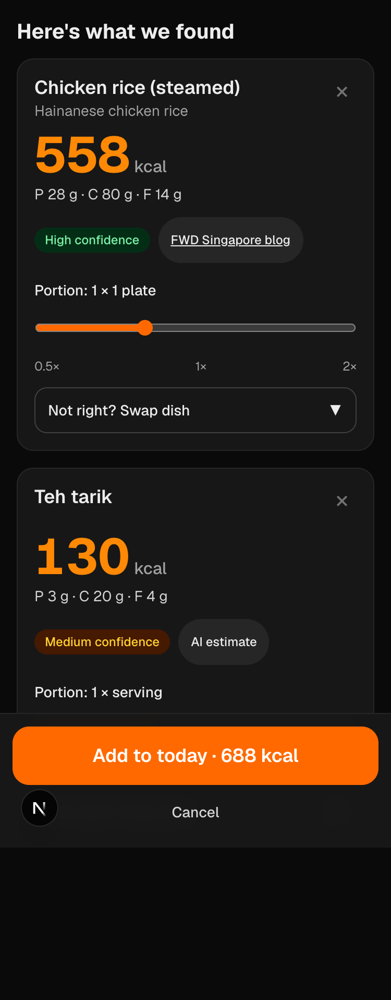

# MakanLens

Snap or describe a Singapore hawker meal and get calories and macros in seconds. Free, open source (MIT), and private: your log lives in your browser.



## Why

Cal AI and MyFitnessPal charge for photo logging. Hawker food is hard for generic trackers: a plate of char kway teow or nasi lemak has no single "correct" entry. MakanLens is free and open, does not require an account, and uses Singapore nutrition data for local food wherever it can: the Health Promotion Board's (HPB) SG FoodID database for about 2,700 items, and curated hawker dishes for the rest. Every number shows where it came from.

## Target: Cal AI

**What it is.** Cal AI is a photo calorie-tracking app: snap a meal, get calories and macros. It is free to download, but photo logging needs a paid "Unlimited" subscription.

**How many people use it.**
- Over 5 million downloads in its first eight months, and over US$2 million revenue in one month (founder's figures; TechCrunch notes it could not verify them). Source: [TechCrunch, 16 Mar 2025](https://techcrunch.com/2025/03/16/photo-calorie-app-cal-ai-downloaded-over-a-million-times-was-built-by-two-teenagers/).
- 373K ratings (4.8 average) on the US App Store. Source: [App Store listing](https://apps.apple.com/us/app/cal-ai-calorie-tracker/id6480417616), checked 31 Oct 2026.

**What it costs today.** The App Store listing shows 10 in-app purchases, with the same "Unlimited" product listed at US$2.99, $5.99, $9.99, $19.99 and $29.99 ([App Store listing](https://apps.apple.com/us/app/cal-ai-calorie-tracker/id6480417616), checked 31 Oct 2026). The commonly reported annual plan is **US$29.99/year ≈ US$2.50 per user per month** ([eesel.ai pricing summary](https://www.eesel.ai/blog/cal-ai-pricing)); weekly plans reported at US$3.99/week come to about US$207/year ([Nutrola](https://nutrola.app/en/blog/why-is-cal-ai-so-expensive)). We use the cheapest figure, US$2.50/month, so the comparison below does not overstate the saving.

## What we uncovered

- **Prices are not fixed.** The public listing shows one product ("Unlimited") at five different prices, which matches reports that the paywall price is tested per user. You cannot know in advance what you will be charged.
- **The expensive part is cheap.** A photo estimate is one vision-model call. With the setup below, one photo costs at most about 0.3 US cents in API tokens on Claude Haiku 5.5 (3 runs), and nothing on Gemini's free tier. The subscription price is not driven by running costs.
- **Generic models guess local food.** A vision model alone invents a calorie figure. MakanLens has the model identify the dish, grams and cooking method only. It then takes calories from published Singapore data (HPB SG FoodID, and 38 curated hawker dishes; see [Data sources and licences](#data-sources-and-licences)) and shows the source on every number.
- **Still to measure:** `/uncovered` compares MakanLens and Cal AI against weighed meals. The weighed test set is not complete yet, so we make no accuracy claim.

## Before and after: cost per user per month

MakanLens supports two vision providers (`VISION_PROVIDER` in `.env.local`). Our test runs used **Claude Haiku 5.5** (`claude-haiku-5-5`, the `anthropic` provider); Gemini is the default in `.env.example` because it has a free tier. Looking up a food in the SG FoodID or curated data makes no API call, so it costs nothing per lookup.

| | Cal AI | MakanLens on Claude Haiku 5.5 (what we ran) | MakanLens on Gemini |
|---|---|---|---|
| Price to the user | US$2.50 (annual plan) to ~US$17 (weekly plan) | **US$0** (MIT, no account, no subscription) | **US$0** |
| API cost, `VISION_RUNS=3` (default) | n/a | **≤ US$0.27** | US$0 free tier; ~US$0.97 paid |
| API cost, `VISION_RUNS=1` | n/a | ≤ US$0.09 | US$0 free tier; ~US$0.32 paid |
| Hosting | n/a | US$0 (Vercel Hobby; no database) | US$0 |

How the API cost is worked out (estimates, assumptions stated). Usage: 3 photos a day × 30 days = 90 photos a month; each photo is sent `VISION_RUNS` times.

- **Claude Haiku 5.5:** US$0.10 per 1M input tokens, US$0.50 per 1M output tokens (prompts under 100K tokens). Source: [Claude API pricing](https://platform.claude.com/docs/en/about-claude/pricing), checked 31 Oct 2026. Per call: about 2,400 input tokens (a photo resized to 1024 px is about 1,400 tokens, using Anthropic's estimate of width × height ÷ 750, plus about 1,000 tokens of prompt) and at most 1,500 output tokens (the `max_tokens` cap in `lib/vision.ts`, which includes thinking). Worst case about US$0.001 per call, so 90 × 3 × 0.001 ≈ **US$0.27** a month. This is an upper bound; typical replies are shorter.
- **Gemini (`gemini-3.8-flash`):** US$0.75 per 1M input, US$3.75 per 1M output on the Standard paid tier, with a free tier also listed. Source: [Gemini API pricing](https://ai.google.dev/gemini-api/docs/pricing), checked 31 Oct 2026. About 2,300 input and 500 output tokens per call is about US$0.0036, so 90 × 3 × 0.0036 ≈ US$0.97. These Gemini prices double from 1 Jan 2027.

**Saving:** Cal AI's cheapest plan is US$2.50 per user per month. MakanLens costs at most US$0.27 per user per month on Claude Haiku 5.5 (at least 89% cheaper, and the user pays nothing if the host covers it), or US$0 on Gemini's free tier.

## Features

### Log a meal: the ＋ Log sheet

Tap **＋ Log** in the tab bar to open one sheet with six ways in:

- **Camera** or **Photo Library**: snap or upload a photo. It is resized in your browser before upload. Tip: a card or fork next to the plate helps with portion size.
- **Describe**: type or speak a meal (Singlish is fine, e.g. "cai fan 2 veg 1 meat, less rice"). Voice input works where the browser supports it.
- **Search**: finds dishes in the local data and your own foods first, then USDA FoodData Central when a `USDA_API_KEY` is set. Pick grams or servings and add it.
- **Barcode**: packaged products from Open Food Facts, by camera or manual entry, per serving or per 100 g.
- **Label**: reads a printed nutrition panel and copies only what is printed (kJ is converted to kcal). Check the values next to the photo before you add them.

### Results

- Each item shows a **kcal range** (e.g. 446–670 kcal) with a best guess, its estimated weight in grams, the cooking method, a confidence badge and a source tag that links to the publisher.
- Adjust the weight with a grams slider (50–800 g), swap the matched dish, or remove an item.
- **One follow-up question** when it matters: if the cooking method or variant would change the calories by more than 15% (e.g. "Steamed or roasted?"), one tap answers it and the range narrows.
- **Learns your portions:** after you correct the grams for a dish twice, future estimates for that dish start at your usual portion, with an Undo.
- Sodium, fibre and saturated fat are shown only where the source lists them. They are never estimated.

### Today

- Calorie ring against your target, protein/carbs/fat bars, and meals grouped by breakfast, lunch, dinner and snack, with edit and delete.
- Weekly budget: "This week: 9,200 of 12,600 kcal", with the kcal left and the days left. Days over or under shift the week's remaining figure only; the daily target itself does not change.
- Exercise add-back: log exercise kcal; with add-back on (the default), the day's target rises by that amount.
- Log again and favourites: recent meals appear on Today. One tap logs a meal again, and a star saves it to Favourites.
- Swap tips: a short tip on a lower-calorie way to order some dishes.

### Trends

- 7-day chart against your target, a month chart, your logging streak and the weekly budget.

### Foods (food library)

- Lists every food in the app: curated dishes, SG FoodID items (where loaded), and your own foods. Search, filter (All, Built-in, Your foods, Edited) and sort A–Z.
- **New food:** name, aliases, serving, kcal, protein, carbs and fat (with a gentle check that the macros add up to the kcal), plus optional sodium, fibre, saturated fat and notes. Foods with a serving weight can be logged by grams.
- **Edit built-in dishes:** saving creates an override and shows an "Edited by you" chip. The original values stay visible, and "Reset to original" restores them. The built-in data itself is never changed.
- Edits apply to future logs. Past meals keep the values they were logged with.
- Duplicate or delete your own foods (with confirmation).

### Profile

- **Health Details:** sex, age, height, weight and activity level. The daily target uses Mifflin-St Jeor BMR × activity factor.
- **Weight Goal** (`/settings/goal`): choose lose, maintain or gain, a rate in kg a week (0.1 kg steps) and a number of weeks (1–52). The planner shows the daily and weekly targets, the target date and the projected weight. Targets are an approximation, using about 7,700 kcal per kg of body weight.
  - **Safety caps** apply automatically, and the app says so when they change your request. Loss is capped at the lower of 1 kg a week or 1% of body weight a week. Gain is capped at 0.5 kg a week. The daily target never goes below 1,200 kcal (women) or 1,500 kcal (men).
  - When the plan ends, you can switch to maintenance or start a new plan.
- **Macro Goals** (`/settings/macros`): a % split (always totals 100%) or fixed grams per macro.
- **Exercise toggle:** turn exercise add-back on or off.
- **Data:** export a CSV of all entries, export a JSON backup (entries, profile, your foods, edits and goal plan), import a backup (merge or replace, with confirmation), or clear all data.
- **About our data** (`/uncovered`): compares MakanLens and Cal AI against weighed meals (run `npm run eval`). Until the weighed test set is complete, the error figures read "awaiting test data".

Not built yet: weight logging and an adaptive calorie target (see Roadmap).

## Design

The app is always dark, in an Apple-style iOS look with an indigo accent. Navigation is a tab bar (Today, Trends, ＋ Log, Foods, Profile), and each page uses a large-title navigation bar. If you change the interface, read [`docs/DESIGN.md`](docs/DESIGN.md) first. It is the design guide for contributors: colour and type tokens, the shared components in `components/ui/`, and the interaction rules.

## How it works

1. You take or upload a photo, or type or speak a description. The image is resized in your browser before upload.
2. A vision model (Claude or Google Gemini) names each dish and drink, estimates its **weight in grams** (with a low–high range) and its **cooking method**, and returns JSON that the server checks against a schema. By default the model is run 3 times in parallel and the results are combined by median (`VISION_RUNS`).
3. **The model never decides the calories.** Code looks up nutrition per 100 g, in this order:
   1. **Your own foods** (on your device), including any edits you have made to curated dishes.
   2. **Curated hawker dishes** in `data/hawker.json`. The cooking method picks the right variant, e.g. roasted vs steamed chicken rice.
   3. **HPB SG FoodID** (`data/sgfoodid.json`), about 2,700 Singapore foods and drinks.
   4. **USDA FoodData Central** (needs `USDA_API_KEY`).
   5. **AI estimate:** only as a last resort, tagged "AI estimate".
4. Calories and macros = per-100 g values × grams; the kcal range comes from the grams range. Every number is tagged with its source.
5. You check the results, adjust them, and add them to today's log. Everything is stored on your device (in `localStorage` and IndexedDB); there are no accounts.

## Setup

You need Node.js 20 or later.

```bash
git clone https://github.com/MajorPlanet/MakanLens.git makanlens
cd makanlens
npm install
cp .env.example .env.local
```

Open `.env.local` and add a key:

- **Gemini (default, free tier):** get a key from Google AI Studio and set `GEMINI_API_KEY`. `GEMINI_MODEL` defaults to `gemini-3.8-flash` if left blank.
- **Claude (optional):** set `VISION_PROVIDER=anthropic` and `ANTHROPIC_API_KEY`. `ANTHROPIC_MODEL` defaults to `claude-haiku-5-5`.
- **USDA (optional):** set `USDA_API_KEY` (free from api.data.gov) so search and lookups can use USDA FoodData Central. `DEMO_KEY` works for light testing. Without a key, search still uses the local data and SG FoodID.
- **Cost control (optional):** `VISION_RUNS` (default 3) sets how many model runs are combined per photo. Set it to 1 to use a third of the API calls.

No other environment variables are needed. The SG FoodID snapshot is already in the repository, so you do not need a key or a network call to use it.

Then start the app:

```bash
npm run dev
```

Open http://localhost:3000.

**No API key?** Set `NEXT_PUBLIC_USE_MOCK=1` in `.env.local` to run the interface with sample results. No API calls are made. Without a key and without mock mode, the app shows a "not configured" message instead of failing silently.

**Testing on a phone:** open the Network URL that `npm run dev` prints, on a device on the same Wi-Fi. Photo upload works over plain HTTP. The live barcode camera needs HTTPS, so use `localhost` or the Vercel deployment for it. Manual barcode entry works anywhere.

### Refresh the SG FoodID snapshot (optional)

`data/sgfoodid.json` is a snapshot taken from HPB's SG FoodID database. You only need to refresh it if HPB has updated the data:

```bash
node scripts/fetch-sgfoodid.mjs            # resumes from the cache in data/cache/sgfoodid
node scripts/fetch-sgfoodid.mjs --refresh  # downloads everything again
```

The script is resumable and rate-limited to about one request every 1.1 seconds, to stay under HPB's limit of 60 requests a minute. A full run takes a while. It rewrites `data/sgfoodid.json`, including the access date and the attribution notice. Keep the attribution text exactly as the script writes it.

### Deploy to Vercel

1. Push the repo to GitHub and import it in Vercel.
2. In Project Settings → Environment Variables, add `VISION_PROVIDER`, `GEMINI_API_KEY` (or `ANTHROPIC_API_KEY`), and optionally `GEMINI_MODEL`, `ANTHROPIC_MODEL`, `USDA_API_KEY` and `VISION_RUNS`. Set `NEXT_PUBLIC_USE_MOCK` to `0`, or leave it unset.
3. Deploy. No database is needed.

Keys are read only on the server (`app/api/**`, `lib/vision.ts` and `lib/usda.ts`). Never give a key a `NEXT_PUBLIC_` prefix.

### Other commands

```bash
npm run build      # production build
npm run lint
npx tsc --noEmit   # type check
npm test           # unit tests (vitest)
npm run eval       # accuracy check against the weighed meals in data/eval/meals.json
```

## Data sources and licences

MakanLens uses four data sources, each credited where its numbers appear in the app.

### HPB SG FoodID (about 2,700 items)

The Singapore Food Insights Database (SG FoodID) from the Health Promotion Board (HPB) gives per-100 g values for Singapore foods and drinks, lab-analysed. It is snapshotted in `data/sgfoodid.json` by `scripts/fetch-sgfoodid.mjs`. Use is under the [SG FoodID Terms of Use](https://file.go.gov.sg/termsofuse-hpbsgfoodid.pdf), sections 10 and 11: you may use, copy, distribute and adapt the data, commercially or not, with a conspicuous attribution notice and no suggestion of HPB endorsement.

Attribution notice (shown in the app and in `data/sgfoodid.json`):

> Contains information from Singapore Food Insights Database (SG FoodID) accessed on 2026-11-11 from Health Promotion Board which is made available under the terms found at https://pphtpc.hpb.gov.sg/web/sgfoodid The information contained within this dataset is provided on an "as-is" basis. The data, including but not limited to nutritional information, is subject to inherent limitations. No warranty or representation is made as to the accuracy or completeness of the data contained herein.

MakanLens is not affiliated with or endorsed by HPB.

### Curated hawker dishes (38 dishes, `data/hawker.json`)

**Important: none of these dishes is marked as verified HPB data.** HPB's older FOCOS database was discontinued in November 2025, so these values come from other published sources. Most come from SingHealth HealthXchange's "Best and Worst Singapore Hawker Food" series, developed with the Dept of Nutrition and Dietetics, KK Women's and Children's Hospital. This covers 33 of the 38 dishes. Other values come from:

- **HealthHub (HPB):** calories and fat for char kway teow. Protein and carbs for that dish come from HealthXchange.
- **FWD Singapore blog**, which cites HPB figures: steamed chicken rice, plain carrot cake and satay. The HPB original could not be checked.
- **USDA FoodData Central:** hard-boiled eggs and brewed black coffee (as a stand-in for kopi-o-kosong).

Most drinks (kopi, teh tarik, teh peng and others) have no published macros in the sources checked, so they are not in the curated dataset. They fall back to an AI estimate or to SG FoodID where HPB lists them. Each dish shows its actual publisher in the app. Full details, including serving weights and caveats, are in [`data/SOURCES.md`](data/SOURCES.md).

### USDA FoodData Central

Public domain (US government data). Used for search and for lookups that are not in SG FoodID or the curated dataset. Needs a free `USDA_API_KEY` for live search; see Setup.

### Open Food Facts

Packaged-product data for barcode lookups, licensed under the [Open Database Licence (ODbL)](https://opendatacommons.org/licenses/odbl/). Credit: [Open Food Facts](https://world.openfoodfacts.org).

### Licence of this project

The MIT Licence applies to the code in this repository. It does not change the terms of the data sources above, which keep their own terms and attribution requirements.

## Disclaimer

Estimates only. Not medical advice.

## Roadmap

- Weight log and an adaptive calorie target (suggested by MacroFactor).
- Compare the 38 curated dishes with their SG FoodID equivalents, and set `verified: true` where a dish is confirmed.
- More hawker dishes and drinks with published values.

## Licence

MakanLens is released under the MIT Licence. See [`LICENSE`](LICENSE).
